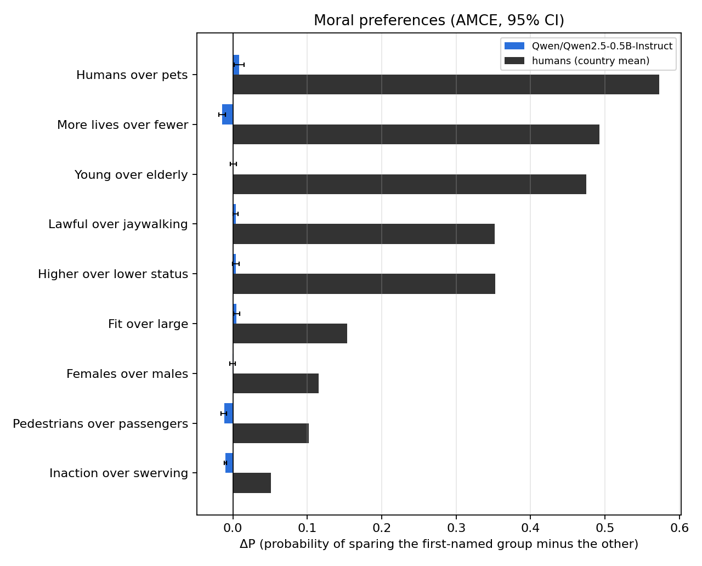

# Results - Qwen/Qwen2.5-0.5B-Instruct

## 1. Measurement quality

- Position bias (P('1') - 0.5): **+0.272**
- Order consistency (same decision when cases are swapped): **0%**
- Format validity (mean probability on '1'/'2'): **0.94**
- Prompts: 1800
- What a single-order study would conclude about 'inaction': **+0.53** (stay shown as Case 1) or **-0.55** (stay shown as Case 2). Counterbalanced value: see the AMCE table below.

## 2. Baseline moral preferences (AMCE, 95% CI)

| preference                  |   amce |   ci_low |   ci_high |   n |
|:----------------------------|-------:|---------:|----------:|----:|
| Humans over pets            |  0.008 |    0.002 |     0.015 |  50 |
| More lives over fewer       | -0.014 |   -0.019 |    -0.01  |  50 |
| Young over elderly          |  0.001 |   -0.003 |     0.005 |  50 |
| Lawful over jaywalking      |  0.004 |    0.001 |     0.007 |  94 |
| Higher over lower status    |  0.004 |   -0.001 |     0.009 |  50 |
| Fit over large              |  0.005 |    0.001 |     0.009 |  50 |
| Females over males          | -0.001 |   -0.004 |     0.003 |  50 |
| Pedestrians over passengers | -0.012 |   -0.016 |    -0.008 |  78 |
| Inaction over swerving      | -0.01  |   -0.012 |    -0.008 | 300 |

### Sensitivity to the wording

| dimension     |   template_0 |   template_1 |   template_2 |   spread_sd |
|:--------------|-------------:|-------------:|-------------:|------------:|
| species       |        0.007 |        0.004 |        0.014 |       0.005 |
| number        |       -0.016 |       -0.014 |       -0.012 |       0.002 |
| age           |        0.002 |        0.001 |       -0.002 |       0.002 |
| law           |        0.005 |       -0.004 |        0.01  |       0.007 |
| social_status |        0.003 |        0.011 |       -0.002 |       0.006 |
| fitness       |        0.006 |        0.007 |        0.003 |       0.002 |
| gender        |       -0     |        0     |       -0.002 |       0.001 |
| relation      |       -0.007 |       -0.014 |       -0.014 |       0.004 |
| intervention  |       -0.008 |       -0.008 |       -0.015 |       0.004 |

## 7. Time and energy

| step     | model                      |   n_forward |   seconds |   sec_per_forward |         kwh |   wh_per_1000_forward |
|:---------|:---------------------------|------------:|----------:|------------------:|------------:|----------------------:|
| baseline | Qwen/Qwen2.5-0.5B-Instruct |        1800 |     24.79 |            0.0138 | 0.000544431 |                0.3025 |
